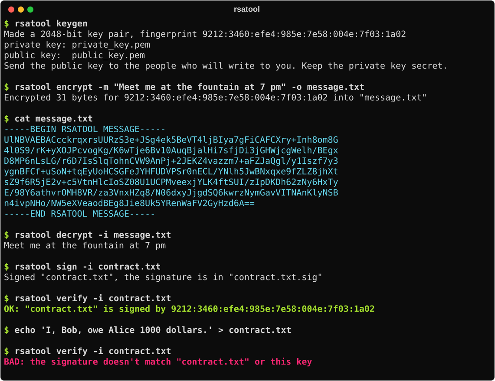
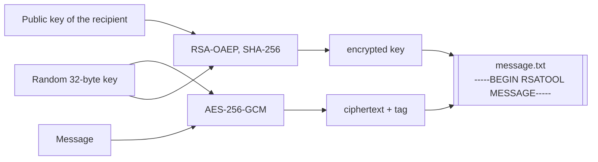

<div align="center">

# 🔐 rsa

**RSA keys, encryption of messages and files of any length, and signatures:
from the command line, from Python, or with three programs you start by
double click.**

[](https://github.com/mredwardlik/rsa/actions/workflows/tests.yml)




</div>

---

## ✨ Features

- 🔑 **Keys** of 2048, 3072 or 4096 bits. The private key can be protected
  with a passphrase (scrypt + AES-256) and is never overwritten by accident
- ✉️ **Messages and files of any length**. RSA alone can encrypt only 190
  bytes, so every message gets its own AES-256 key, and only that key is
  encrypted with RSA
- 🛡 **Tamper detection**: AES-GCM checks every byte, a changed message isn't
  decrypted
- 📋 **Text form** to paste into a chat or an email. Line breaks and text
  around it that a messenger may add are ignored
- ✍️ **Signatures** (RSA-PSS, SHA-256) to prove who wrote a file and that it
  wasn't changed
- 🧾 **Fingerprints** to compare keys over the phone
- 🖱 **Double-click programs** `generator`, `encryptor`, `decryptor` for
  people who don't use the command line
- ♻️ Messages made by the first version of the scripts (2021) still decrypt

## 🔄 How it works



Only the owner of the private key can decrypt the AES key, and with it the
message. The format is described in [`rsatool/cipher.py`](rsatool/cipher.py).

## 📦 Installation

```bash
git clone https://github.com/mredwardlik/rsa.git
cd rsa
pip install .
```

This adds the `rsatool` command. Python 3.10+ and
[PyCryptodome](https://www.pycryptodome.org) are needed.

## 🚀 Usage

### Command line

```bash
rsatool keygen                      # private_key.pem and public_key.pem
rsatool keygen -b 4096 -p           # bigger key, protected with a passphrase
rsatool info public_key.pem         # size and fingerprint

rsatool encrypt -m "Hello"                        # prints the text form
rsatool encrypt -k bob.pem -m "Hello" -o msg.txt  # for Bob, into a file
rsatool encrypt -i photo.jpg -o photo.enc --binary

rsatool decrypt -i msg.txt                        # prints the message
rsatool decrypt -i photo.enc -o photo.jpg

rsatool sign -i contract.pdf                      # contract.pdf.sig
rsatool verify -k alice.pem -i contract.pdf       # exit code 0 or 1
```

Without `-m` or `-i` the data is read from stdin, so pipes work:

```bash
echo "secret" | rsatool encrypt | rsatool decrypt
```

`encrypt`, `verify` and `info` take the public key (`public_key.pem` by
default), `decrypt` and `sign` take your private key (`private_key.pem`). The
passphrase is asked when it's needed, or taken from the `RSATOOL_PASSPHRASE`
environment variable in scripts.

### Double-click programs

```text
create.bat    →    dist\generator.exe   dist\encryptor.exe   dist\decryptor.exe
```

`create.bat` makes a virtual environment, installs the package and builds
three .exe files with PyInstaller. Without building, run `python generator.py`
and so on. Each program works with files next to it:

1. **Bob** runs `generator` and sends `public_key.pem` to Alice. The private
   key stays with him.
2. **Alice** puts `public_key.pem` next to `encryptor`, types the message and
   sends Bob the `message.txt` it makes (or the text it shows).
3. **Bob** puts `message.txt` next to `decryptor` and reads the message.

### Python

```python
import rsatool

key = rsatool.generate(2048)
blob = rsatool.encrypt('Привет!'.encode(), key.public_key())
text = rsatool.armor(blob)                  # -----BEGIN RSATOOL MESSAGE----- ...
assert rsatool.decrypt(text, key) == 'Привет!'.encode()

signature = rsatool.sign(b'data', key)
assert rsatool.verify(b'data', signature, key.public_key())

private = rsatool.load_private('private_key.pem', passphrase='...')
print(rsatool.fingerprint(private))         # 2b80:e9d4:7178:aa52:...
```

Errors are subclasses of `rsatool.RsaToolError`: `KeyFileError`,
`PassphraseRequired`, `DecryptionError` (wrong key or changed message) and
`FormatError`.

## 🛠 Development

```bash
pip install -e ".[dev]"
pytest
```

The tests cover round trips of text and binary data, wrong keys, changed and
cut messages, passphrases, signatures, the command line with pipes, the
double-click programs and old messages.

## 🗂 Project structure

```text
rsa/
├── rsatool/
│   ├── keys.py          # generate, save, load, fingerprint
│   ├── cipher.py        # RSA-OAEP + AES-256-GCM, text form
│   ├── signature.py     # RSA-PSS
│   ├── cli.py           # rsatool command
│   └── interactive.py   # generator, encryptor, decryptor
├── generator.py, encryptor.py, decryptor.py   # entry points for the .exe files
├── create.bat           # builds the .exe files
└── tests/
```

## 📄 License

[MIT](LICENSE)
